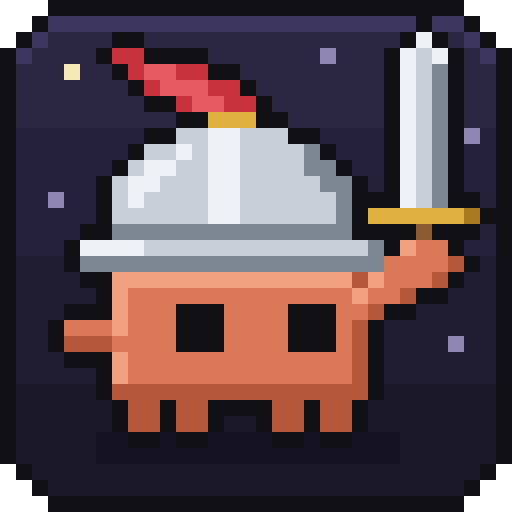
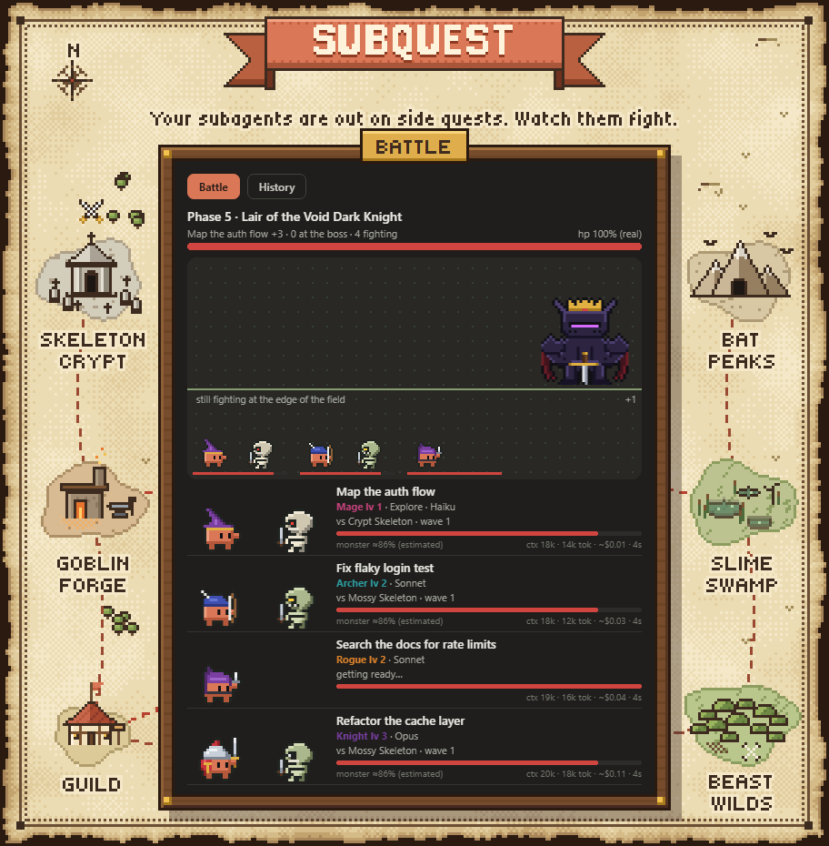
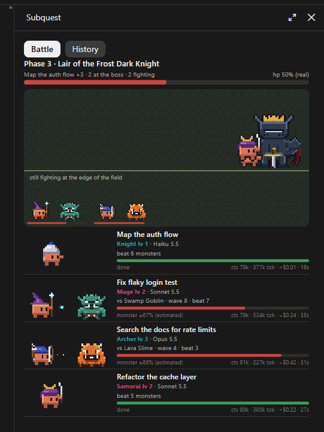
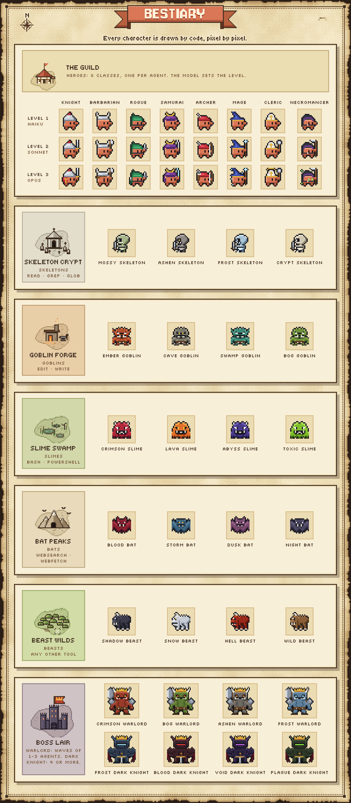
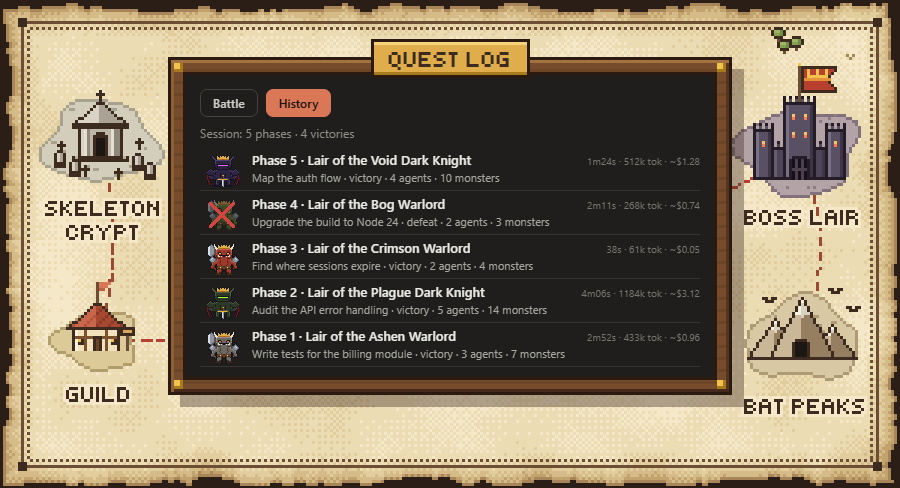
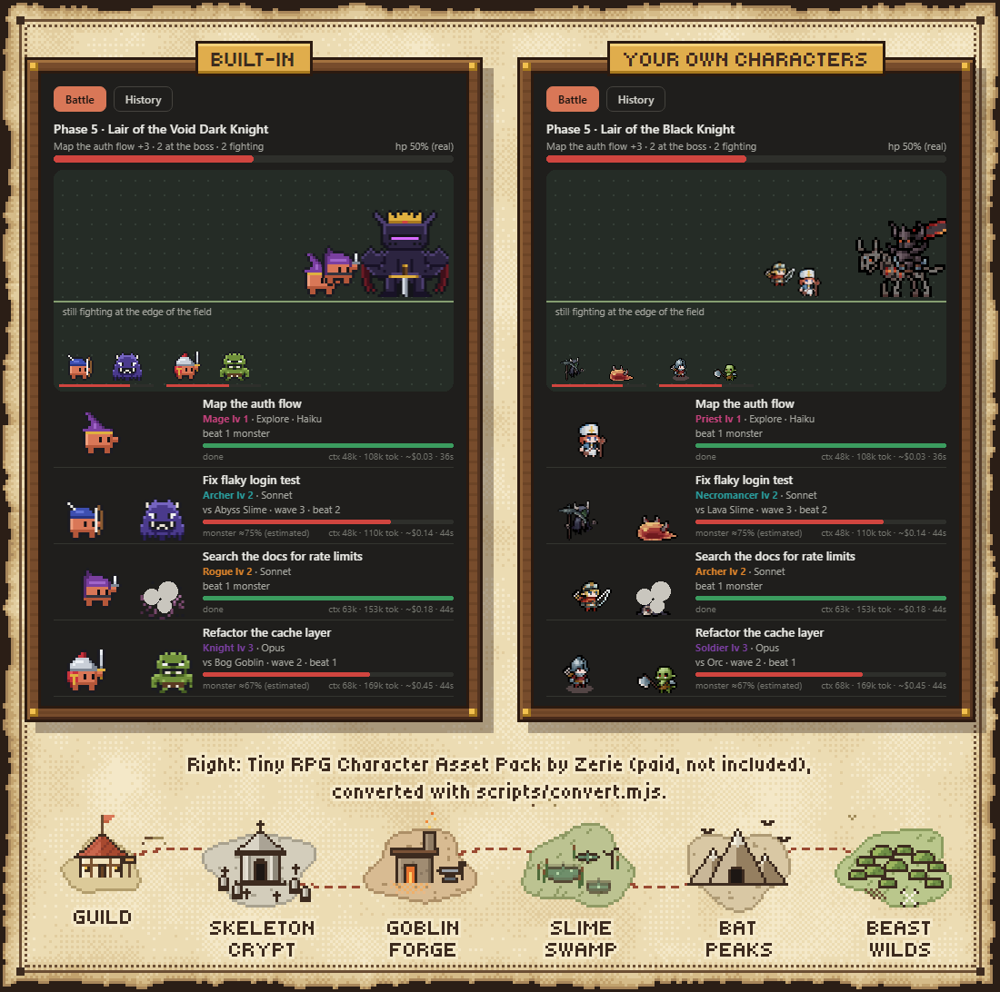

<p align="center">
  
</p>

<h1 align="center">Subquest</h1>

<p align="center">
  <em>Your subagents are out on side quests. Watch them fight.</em><br>
  A live RPG pane for Claude Code. Zero tokens.
</p>

<p align="center">
  English · <a href="README.pt-BR.md">Português (Brasil)</a>
</p>

<p align="center">
  
  <a href="LICENSE"></a>
  <a href="https://github.com/brunocmattos/subquest/stargazers"></a>
  
  
  <br>
  
  
  
  
</p>

<p align="center">
  
</p>

<p align="center">
  <br>
  <sub>The real thing, inside Claude Code.</sub>
</p>

> ⭐ If Subquest made you smile, star it. That's how other devs find it.

## ⚔️ Quick start

In Claude Code:

```
/plugin marketplace add brunocmattos/subquest
/plugin install subquest@subquest
```

Or in one step (Claude Code 2.1.275 or later):

```
/plugin install subquest --marketplace brunocmattos/subquest
```

Now spawn some subagents and watch. The pane opens by itself when a new wave starts; `/subquest` shows or hides it.

## 🗡️ How it works

- **Every subagent is a hero.** Clawd, Claude's crab, suits up in one of 8 classes.
- **The tool it's using is the monster.** Reading files? Skeletons. Running commands? Slimes.
- **Agents spawned together are a wave**, and every wave faces a crowned boss.
- **The model is the level.** Haiku gets a hat, Sonnet a weapon, Opus the full kit.

Each hero card also shows the real numbers: context, tokens, estimated cost and time.

## 🧙 Choose your class

<p align="center">
  
</p>

You don't pick the class. The dice do: the agent's id rolls one, so the same agent always comes back as the same hero. Same goes for the accent color.

| Class | Style | Lv 1 · Haiku | Lv 2 · Sonnet | Lv 3 · Opus |
|---|---|---|---|---|
| Knight | melee | plumed great helm | + sword | + kite shield |
| Barbarian | melee | horned helm | + big axe | + fur mantle and war paint |
| Rogue | melee | hood and mask | + dagger | + second dagger and cloak |
| Samurai | melee | crested kabuto | + katana | + glowing blade and shoulder plate |
| Archer | arrow | feathered cap | + bow | + quiver |
| Mage | magic | tall pointed hat | + orb staff | + floating sparks |
| Cleric | magic | white mitre | + mace | + halo |
| Necromancer | magic | deep hood | + scythe | + soul fire |

Any model that isn't Haiku or Opus fights at level 2.

## 👹 Bestiary

| Family | Tools | Monster |
|---|---|---|
| read | `Read`, `Grep`, `Glob` | Skeleton |
| edit | `Edit`, `Write`, `MultiEdit`, `NotebookEdit` | Goblin |
| command | `Bash`, `PowerShell` | Slime |
| web | `WebSearch`, `WebFetch` | Bat |
| other | everything else | Beast |

Every monster rolls its look and name from a seed: you'll meet a *Crypt Skeleton*, a *Toxic Slime*, a *Storm Bat*. When an agent switches tool family, the current monster drops dead and a fresh one walks in. Hits land with damage numbers and the odd crit. Monster HP is an estimate (nobody knows how long a task will take, not even the monster).

**Bosses.** Each wave is a phase, titled *Phase N · Lair of the &lt;boss&gt;*, plus the first agent's task and a "+N" for the rest of the party.

- **Warlord** guards waves of 1 to 3 agents.
- **Dark Knight** shows up for 4 or more.
- Each phase rolls its own variant: *Crimson Warlord*, *Void Dark Knight* and friends.

Boss HP is real: it drops as agents finish. Heroes who are done walk over and hit the boss. Everyone finishes well and you get **PHASE CLEARED**; anyone falls and it's a partial defeat.

## 📜 Quest log

<p align="center">
  
</p>

The **History** tab keeps every finished phase of the session, newest first: boss, victory or defeat, agents, monsters beaten, time, tokens and estimated cost.
On top, the session score: phases played and victories.

## 🎨 Bring your own heroes

Don't like crabs? (Who hurt you?) Drop JSON files in `~/.claude/subquest/packs/` and they take over a slot:

- **hero**: your heroes replace *all* built-in heroes.
- **monster**: replaces one family (`read`, `edit`, `command`, `web` or `other`).
- **boss**: replaces one size: `small` is the Warlord slot (1 to 3 agents), `big` the Dark Knight slot (4 or more).

Several files in the same slot? The seed picks one per agent or per phase. A file that doesn't parse is skipped with a notice and the built-in art fills in.

A tiny, valid monster:

```json
{
  "kind": "monster",
  "family": "command",
  "name": { "en": "Pocket Slime", "pt-BR": "Lodo de Bolso" },
  "w": 5,
  "h": 4,
  "palette": ["#1b1420", "#7fbf2a", "#b4e65a"],
  "anim": {
    "idle": ["1.0.3.0;0.1.1.0;1.1.2.1;3.1.1.2;4.1.1.0;0.2.1.0;1.2.3.1;4.2.1.0;0.3.5.0", "0.1.5.0;0.2.1.0;1.2.2.1;3.2.1.2;4.2.1.0;0.3.5.0"],
    "attack": ["0.1.5.0;0.2.1.0;1.2.2.1;3.2.1.2;4.2.1.0;0.3.5.0", "1.0.3.0;0.1.1.0;1.1.2.1;3.1.1.2;4.1.1.0;0.2.1.0;1.2.3.1;4.2.1.0;0.3.5.0"],
    "hurt": ["1.0.3.2;0.1.5.2;0.2.5.2;0.3.5.0"],
    "death": ["0.2.5.1;0.3.5.0", "0.3.5.0"]
  }
}
```

The rules:

- `kind`: `hero`, `monster` or `boss`. Heroes take a `style` (`melee`, `arrow` or `magic`; default `melee`), monsters a `family`, bosses a `size` (default `small`).
- `name`: a string, or `{ "en": "...", "pt-BR": "..." }`.
- `w`, `h`: 1 to 128 pixels.
- `palette`: `#rrggbb` colors.
- `anim`: `idle`, `attack`, `hurt` and `death`, each a list of one or more frames. A frame is runs of `x.y.length.color` joined by `;`, where `color` is an index into `palette`.
- Heroes face right; monsters and bosses face left.

A full 16×16 hero lives in [`examples/characters/ember-knight.json`](examples/characters/ember-knight.json). Copy it into your packs folder to try it.

Packs are read when a session starts, so after adding or changing them, start a new session.

**Got sprite sheets?** The converter turns PNG sheets (frames side by side in one row) into packs:

```
node scripts/convert.mjs examples/convert-map.json
```

The map says where the sheets live (`source`, searched recursively, relative to where you run the command), the frame width in pixels (`frame`), and which file is each animation of each character. `mirror: true` flips sheets drawn facing the wrong way. Output goes to `~/.claude/subquest/packs/` unless you pass a folder as the second argument. It reads 8-bit RGBA PNGs and keeps up to 24 colors per character. See [`examples/convert-map.json`](examples/convert-map.json).

<p align="center">
  <br>
  <sub>Custom characters shown: <a href="https://zerie.itch.io/tiny-rpg-character-asset-pack"><em>Tiny RPG Character Asset Pack</em> by Zerie</a> (paid, not included)</sub>
</p>

**No sprites yet?** Draw and animate them in [Aseprite](https://www.aseprite.org/) or [PixelLab](https://www.pixellab.ai/), export each animation as a sheet, and run the converter above.

## ❓ FAQ

**Does it cost tokens?**
No. Subquest only listens to engine events (agent spawned, tool called, step done, turn finished) and draws. It never talks to the model.

**Does it work in the terminal?**
Yes. In a terminal surface the pane switches to a text version of the same battle.

**Is the cost real?**
It's an estimate: token counts times the public prices per model. Your bill is the final boss.

**Where do custom characters go?**
`~/.claude/subquest/packs/*.json`. One character per file.

**I changed my characters and nothing happened.**
Start a new session. Packs load at session start, and `/reload-plugins` only reloads the mod when its own files change.

**How do I switch language?**
`/subquest lang pt-BR` or `/subquest lang en`. By default it follows your Claude Code `language` setting, then your system, then English.

**Does it respect reduced motion?**
It animates by default, on purpose: the fight *is* the feature. `/subquest motion off` draws still pictures instead and remembers it across sessions; `/subquest motion on` brings the fight back.

## 🤝 Contributing

New classes, monsters, bug reports and bad puns are all welcome. Read [CONTRIBUTING.md](CONTRIBUTING.md) before you roll initiative.

<p align="center">
  <a href="https://star-history.com/#brunocmattos/subquest&Date">
    
  </a>
</p>

Every star is +1 XP for the party. ⭐

## 📄 License

MIT © Bruno Campos de Mattos. See [LICENSE](LICENSE).
