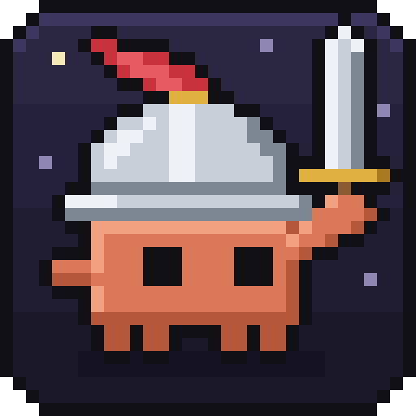
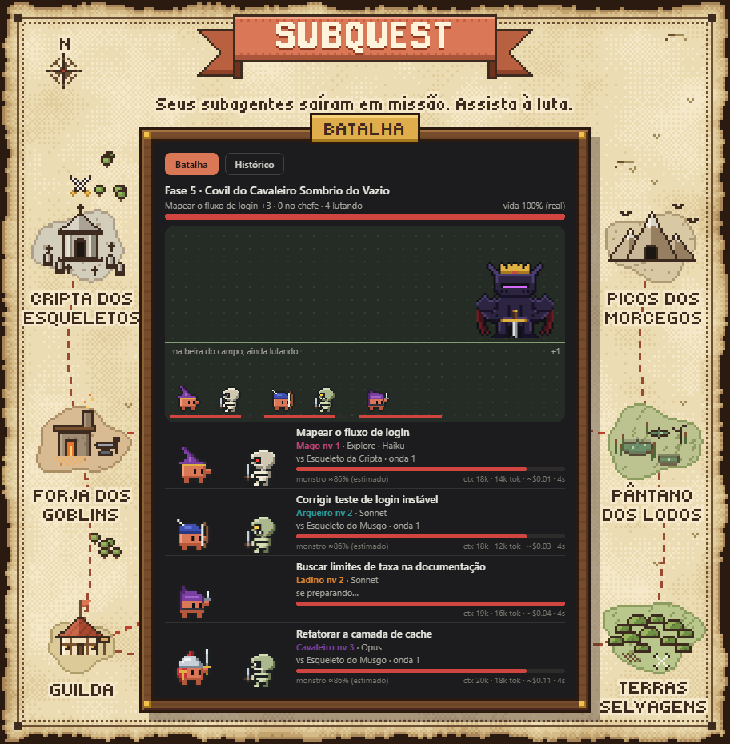
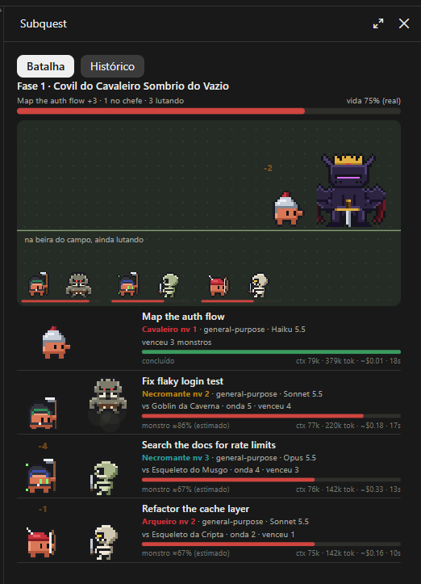
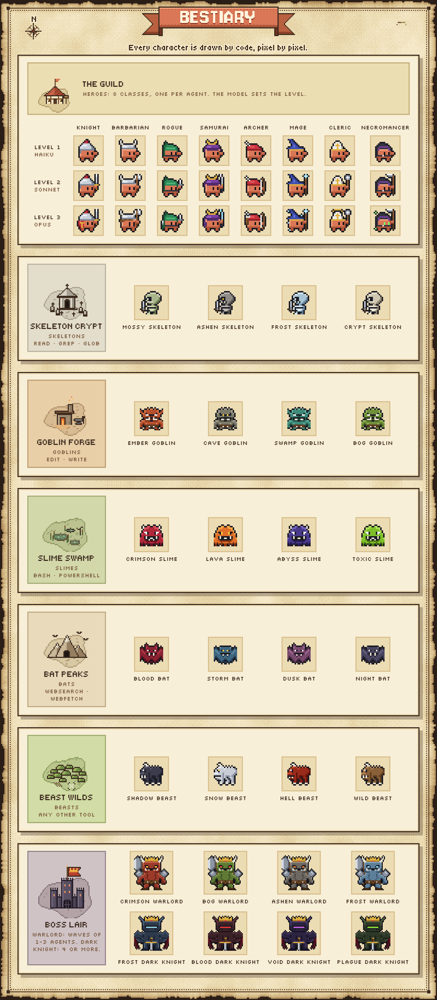
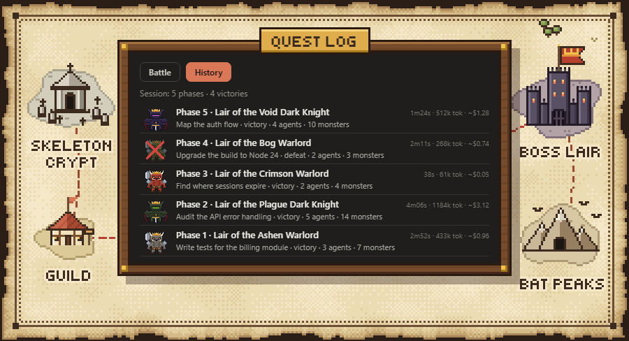
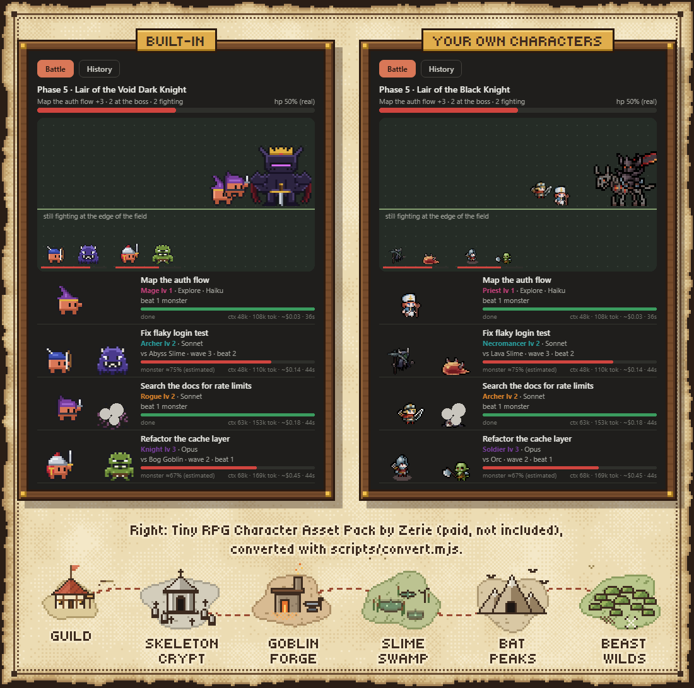

<p align="center">
  
</p>

<h1 align="center">Subquest</h1>

<p align="center">
  <sub>a Guilda dos Subagentes</sub>
</p>

<p align="center">
  <em>Seus subagentes saíram em missões paralelas. Assista à pancadaria.</em><br>
  Um painel de RPG ao vivo pro Claude Code. Zero tokens.
</p>

<p align="center">
  <a href="README.md">English</a> · Português (Brasil)
</p>

<p align="center">
  
  <a href="LICENSE"></a>
  <a href="https://github.com/brunocmattos/subquest/stargazers"></a>
  
  
  <br>
  
  
  
  
</p>

<p align="center">
  
</p>

<p align="center">
  <br>
  <sub>O de verdade, dentro do Claude Code.</sub>
</p>

> ⭐ Se o Subquest te arrancou um sorriso, deixa uma estrela. É assim que outros devs encontram ele.

## ⚔️ Começo rápido

No Claude Code:

```
/plugin marketplace add brunocmattos/subquest
/plugin install subquest@subquest
```

Ou num passo só (Claude Code 2.1.275 ou mais novo):

```
/plugin install subquest --marketplace brunocmattos/subquest
```

Agora solta uns subagentes e assiste. O painel abre sozinho quando começa uma nova onda; `/subquest` mostra ou esconde.

## 🗡️ Como funciona

- **Cada subagente é um herói.** O Clawd, o caranguejo do Claude, veste uma de 8 classes.
- **A ferramenta que ele usa é o monstro.** Lendo arquivo? Esqueletos. Rodando comando? Lodos.
- **Agentes abertos juntos formam uma onda**, e toda onda enfrenta um chefe coroado.
- **O modelo é o nível.** Haiku ganha um chapéu, Sonnet uma arma, Opus o equipamento completo.

Cada herói também mostra os números de verdade: contexto, tokens, custo estimado e tempo.

## 🧙 Escolha sua classe

<p align="center">
  
</p>

Você não escolhe a classe. Os dados escolhem: o id do agente rola uma, então o mesmo agente sempre volta como o mesmo herói. A cor de destaque também.

| Classe | Estilo | Nv 1 · Haiku | Nv 2 · Sonnet | Nv 3 · Opus |
|---|---|---|---|---|
| Cavaleiro | corpo a corpo | elmo com penacho | + espada | + escudo |
| Bárbaro | corpo a corpo | elmo com chifres | + machadão | + manto de pele e pintura de guerra |
| Ladino | corpo a corpo | capuz e máscara | + adaga | + segunda adaga e capa |
| Samurai | corpo a corpo | kabuto com crista | + katana | + lâmina brilhante e ombreira |
| Arqueiro | flecha | chapéu de pena | + arco | + aljava |
| Mago | magia | chapéu pontudo | + cajado com orbe | + faíscas flutuando |
| Clérigo | magia | mitra branca | + maça | + auréola |
| Necromante | magia | capuz fundo | + foice | + fogo de alma |

Qualquer modelo que não seja Haiku nem Opus luta no nível 2.

## 👹 Bestiário

| Família | Ferramentas | Monstro |
|---|---|---|
| leitura | `Read`, `Grep`, `Glob` | Esqueleto |
| edição | `Edit`, `Write`, `MultiEdit`, `NotebookEdit` | Goblin |
| comando | `Bash`, `PowerShell` | Lodo |
| web | `WebSearch`, `WebFetch` | Morcego |
| outras | todo o resto | Fera |

Cada monstro rola visual e nome de uma semente: você vai topar com um *Esqueleto da Cripta*, um *Lodo Tóxico*, um *Morcego da Tempestade*. Quando o agente troca de família de ferramenta, o monstro atual cai duro e um novo entra em cena. Os golpes vêm com números de dano e, de vez em quando, um crítico. A vida do monstro é estimada (ninguém sabe quanto uma tarefa vai demorar, nem o monstro).

**Chefes.** Cada onda é uma fase, com o título *Fase N · Covil do &lt;chefe&gt;*, mais a tarefa do primeiro agente e um "+N" pro resto do grupo.

- **Senhor da Guerra** guarda ondas de 1 a 3 agentes.
- **Cavaleiro Sombrio** aparece pra 4 ou mais.
- Cada fase rola sua variante: *Senhor da Guerra Carmesim*, *Cavaleiro Sombrio do Vazio* e companhia.

A vida do chefe é real: cai conforme os agentes terminam. Herói que terminou vai lá e bate no chefe. Todo mundo terminou bem, aparece **FASE CONCLUÍDA**; alguém caiu, é derrota parcial.

## 📜 Diário de missões

<p align="center">
  
</p>

A aba **Histórico** guarda cada fase terminada na sessão, da mais nova pra mais antiga: chefe, vitória ou derrota, agentes, monstros vencidos, tempo, tokens e custo estimado.
No topo, o placar da sessão: fases jogadas e vitórias.

## 🎨 Traga seus próprios heróis

Não curte caranguejo? (Quem te machucou?) Coloca arquivos JSON em `~/.claude/subquest/packs/` e eles assumem uma vaga:

- **hero**: seus heróis substituem *todos* os heróis embutidos.
- **monster**: substitui uma família (`read`, `edit`, `command`, `web` ou `other`).
- **boss**: substitui um tamanho: `small` é a vaga do Senhor da Guerra (1 a 3 agentes), `big` a do Cavaleiro Sombrio (4 ou mais).

Vários arquivos na mesma vaga? A semente escolhe um por agente ou por fase. Arquivo que não passa na leitura é ignorado com um aviso, e a arte embutida cobre.

Um monstro minúsculo e válido:

```json
{
  "kind": "monster",
  "family": "command",
  "name": { "en": "Pocket Slime", "pt-BR": "Lodo de Bolso" },
  "w": 5,
  "h": 4,
  "palette": ["#1b1420", "#7fbf2a", "#b4e65a"],
  "anim": {
    "idle": ["1.0.3.0;0.1.1.0;1.1.2.1;3.1.1.2;4.1.1.0;0.2.1.0;1.2.3.1;4.2.1.0;0.3.5.0", "0.1.5.0;0.2.1.0;1.2.2.1;3.2.1.2;4.2.1.0;0.3.5.0"],
    "attack": ["0.1.5.0;0.2.1.0;1.2.2.1;3.2.1.2;4.2.1.0;0.3.5.0", "1.0.3.0;0.1.1.0;1.1.2.1;3.1.1.2;4.1.1.0;0.2.1.0;1.2.3.1;4.2.1.0;0.3.5.0"],
    "hurt": ["1.0.3.2;0.1.5.2;0.2.5.2;0.3.5.0"],
    "death": ["0.2.5.1;0.3.5.0", "0.3.5.0"]
  }
}
```

As regras:

- `kind`: `hero`, `monster` ou `boss`. Herói leva um `style` (`melee`, `arrow` ou `magic`; padrão `melee`), monstro uma `family`, chefe um `size` (padrão `small`).
- `name`: um texto, ou `{ "en": "...", "pt-BR": "..." }`.
- `w`, `h`: de 1 a 128 pixels.
- `palette`: cores `#rrggbb`.
- `anim`: `idle`, `attack`, `hurt` e `death`, cada uma com um ou mais quadros. Um quadro é uma sequência de `x.y.comprimento.cor` separada por `;`, onde `cor` é o índice na `palette`.
- Herói olha pra direita; monstro e chefe olham pra esquerda.

Um herói 16×16 completo mora em [`examples/characters/ember-knight.json`](examples/characters/ember-knight.json). Copia pra sua pasta de packs e testa.

Os packs são lidos quando a sessão começa, então depois de adicionar ou mudar, abre uma sessão nova.

**Tem sprite sheet?** O conversor transforma folhas PNG (quadros lado a lado numa linha) em packs:

```
node scripts/convert.mjs examples/convert-map.json
```

O mapa diz onde as folhas estão (`source`, buscada em subpastas, relativa a onde você roda o comando), a largura do quadro em pixels (`frame`) e qual arquivo é cada animação de cada personagem. `mirror: true` vira as folhas desenhadas olhando pro lado errado. A saída vai pra `~/.claude/subquest/packs/`, a não ser que você passe uma pasta como segundo argumento. Ele lê PNG RGBA de 8 bits e guarda até 24 cores por personagem. Veja [`examples/convert-map.json`](examples/convert-map.json).

<p align="center">
  <br>
  <sub>Personagens personalizados na imagem: <a href="https://zerie.itch.io/tiny-rpg-character-asset-pack"><em>Tiny RPG Character Asset Pack</em>, de Zerie</a> (pago, não incluído)</sub>
</p>

Um criador de sprites vem aí.

## ❓ Perguntas frequentes

**Gasta tokens?**
Não. O Subquest só escuta eventos do motor (agente aberto, ferramenta chamada, passo feito, turno encerrado) e desenha. Ele nunca conversa com o modelo.

**Funciona no terminal?**
Funciona. Numa superfície de terminal o painel vira uma versão em texto da mesma batalha.

**O custo é real?**
É estimado: tokens vezes os preços públicos de cada modelo. O chefão final é a sua fatura.

**Onde ficam os personagens personalizados?**
Em `~/.claude/subquest/packs/*.json`. Um personagem por arquivo.

**Mudei meus personagens e nada aconteceu.**
Abre uma sessão nova. Os packs carregam no início da sessão, e o `/reload-plugins` só recarrega o mod quando os arquivos dele mudam.

**Como troco o idioma?**
`/subquest lang pt-BR` ou `/subquest lang en`. Por padrão ele segue a configuração `language` do Claude Code, depois o sistema, e por último o inglês.

**Respeita a redução de movimento?**
Anima mesmo assim, de propósito. A luta *é* a feature.

## 🤝 Contribuindo

Classes novas, monstros, relatos de bug e trocadilhos ruins, tudo bem-vindo. Lê o [CONTRIBUTING.md](CONTRIBUTING.md) antes de rolar a iniciativa.

<p align="center">
  <a href="https://star-history.com/#brunocmattos/subquest&Date">
    
  </a>
</p>

Cada estrela é +1 de XP pro grupo. ⭐

## 📄 Licença

MIT © Bruno Campos de Mattos. Veja [LICENSE](LICENSE).
